# Spike: boolean cut and split on the Dexter Quiet hull, welded by the operator's rule

Campaign brush-tree, target r3 (invariants weld-rule, detail-is-boolean, two-layers, shippable-stack). Serves rulings
`boolean-cleanup-tighter-curve-wins` and `panel-lines-by-split-boolean-r2`. Plan: Imagination's `spike-boolean-weld.md`.
Agent `spike-bt-boolean-weld`, 2026-10-12. A spike, not a cut: the code under `spikes/boolean-weld/` is scratch.

Her words, the spec of the rule: "the surface with the tighter curve defines the silhouette of the cut, and the spare
vertices that come from the flatter surface all get merged away."

## Round 4: Self's calls (a) to (f) under target r4

Agent `hands-bt-weld-spike-r4`, session `self-2026-10-13-ag`, 2026-10-13. Target r4 (`brush-tree:target:r4`, doc
@ 40faab6) is in force; rulings `weld-owner-local-corners-kept`, `brush-modes-add-subtract-split`,
`weld-runs-as-live-result-object`, `blender-evaluates-cages`, `paint-after-commit`; follow-up
`aetheria-release:follow_up:weld-result-uv0-ownership`.

How it was run (all on Starfire, Windows; one job at a time):

- **Input:** Blender 5.2.2's evaluated mesh without the Bevel, as before (`fixtures/hull_nobevel.obj`). For UVs,
  `py/export_uv.py` gives the hand cage a stand-in UV0 (Smart UV Project on the cage, 66 deg, mirrored half offset
  by 1 in U; she has no unwrap yet: the cage's `UVMap` layer was there but unused) and exports the evaluated mesh with
  per-corner UVs (`fixtures/hull_uv.obj`). Its positions equal the fixture's to 2e-7 (the OBJ's 7 decimals): 3,010
  vertices, 3,008 quads, 11 UV islands. Nothing was saved to any .blend.
- **Kernel:** boolmesh 0.2.1 through the spike driver, now with `add` (union).
- **CDT:** the driver's new `cdt` subcommand over **spade 2.15.1**. Its crate metadata reads
  `license = "MIT OR Apache-2.0"` (`Cargo.toml` of the downloaded crate; `cargo info spade` agrees). Settings:
  angle limit 20 deg, `keep_constraint_edges()` (no constraint edge is split), `exclude_outer_faces(true)`. The driver
  asserts that spade keeps the input vertices in order and unmoved. 177 calls, all `refinement_complete`, 1,051
  Steiner points. Triangle is gone from the spike: `py/round3.py` is deleted and `py/round4.py` replaces it.
- **Weld:** `py/round4.py` with guard floor 5 deg; `py/owner_weld.py` without the `snap` kind (b).
- **Finishing and renders:** `py/render_blender.py` headless, the cage's own Bevel and Weighted Normal settings
  (0.001, one segment, clamp overlap on), Workbench. Loop edges and hull crease edges carry bevel weight 1; brush
  edges carry none in these renders (see the add-mode note).
- **Tables:** `spikes/boolean-weld/results/round4/` (`table4.md`, `measures4.json`, `bevel_uv.json`).

### (a) Slide onto the seam: flat split before and after

Look at these first: same pipeline (short seam merge, flips, spade cap CDT), without and with the slide.

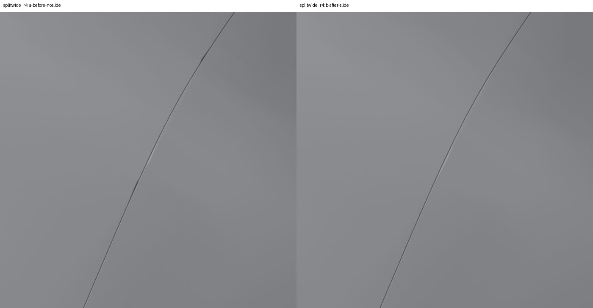
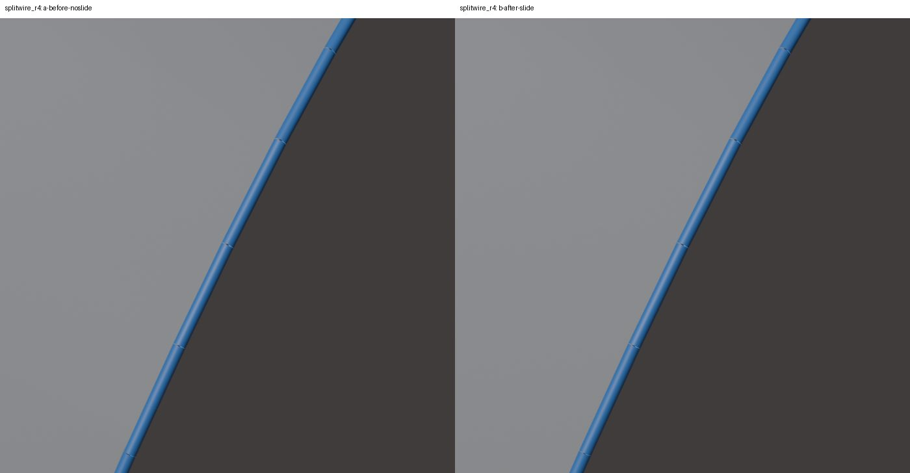
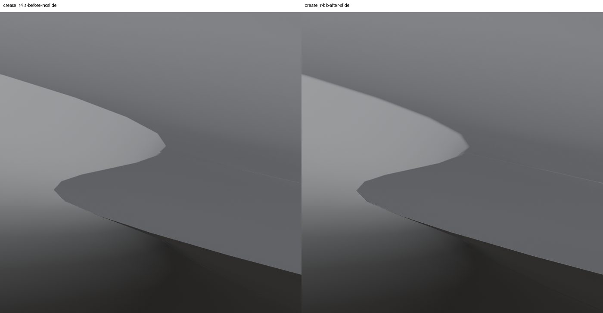

What the slide does, as built:

- A hull vertex H, never a crease vertex, a corner or a UV0 seam vertex, whose own edges cross the seam at
  consecutive seam vertices C(H), slides inside its own surface to the nearest point M of the seam between them,
  if that is closer than the bevel width. C(H) merge into it, so the seam passes through H's new position.
- M lies on the intersection, so the seam stays on the plane (off-plane 0 in every row). In the other piece of the
  split (where H is absent) the first C(H) vertex moves to M and the rest merge into it. The two seams stay identical
  (crack 0.0).
- Every operation is judged on its end state over both pieces: no touched face inverts, and the worst angle over
  the touched faces (deleted ones included) does not end below 5 deg if it got worse. Round 3's per-step guard
  refused all 7 candidates on the split, because the first step (moving H) flattens a face that the merges then
  delete. The short seam merge now uses the same guard.
- Round 3's diagnosis was half wrong. The split's 0.68 deg needle is two boolean-inserted seam vertices 0.00034
  apart (crossings of two edges of one hull vertex), not a hull vertex on a seam vertex. That hull vertex lies on the
  removed side, in the other piece. The short merge (round 3's call, now with the end-state guard) or the slide
  removes it.

| flat split | variant | hull slivers | hull worst deg | hull p5 | cap slivers | cap worst | seam-adjacent edges < bevel width | shortest seam-adjacent edge | crack |
|---|---|---|---|---|---|---|---|---|---|
| panel split, subtract piece | naive | 37 | 0.68 | 3.9 | 60 | 0.058 | 15 | 0.00026 | 0 |
| | before (no slide) | 23 | 1.37 | 5.7 | 6 | 7.6 | 6 | 0.00030 | 0 |
| | after (slide) | 19 | 1.37 | 6.8 | 8 | 6.8 | 4 | 0.00030 | 0 |
| panel split, intersect piece | before | 16 | 2.51 | 6.7 | 6 | 7.6 | 5 | 0.00079 | 0 |
| | after | 18 | 2.51 | 5.6 | 8 | 6.8 | 5 | 0.00079 | 0 |
| crease box, subtract piece | naive | 22 | 0.38 | 3.7 | 22 | 0.033 | 12 | 1.5e-5 | 0 |
| | before | 12 | 2.36 | 6.8 | 0 | 6.9 | 6 | 1.3e-4 | 0 |
| | after | 9 | 2.51 | 7.3 | 0 | 7.4 | 1 | 9.9e-4 | 0 |
| crease box, intersect piece | before | 10 | 1.40 | 7.1 | 0 | 6.9 | 5 | 1.5e-4 | 0 |
| | after | 7 | 2.08 | 7.3 | 0 | 7.4 | 0 | 1.0e-3 | 0 |

- **Moves:** split 4 slides (10 seam vertices merged), crease box 3 (6 merged). The largest move is 0.00087 on the
  split and 0.00084 on the crease box, below the 0.001 bevel width. Each moved vertex stays on its own hull edges.
- **Without UV0 seam protection** the split took 5 slides and the subtract piece reached worst 2.1 deg, 2
  short edges. The extra slide sat on a UV0 seam and tore the UVs (stretch 820x), so the protected run is the one
  reported. Geometry and UV seams compete at that one spot.
- **Render:** the slide removes the dark smear at the lower end of the seam. A light wedge remains in the middle.
  It sits where seam-adjacent edges stay under the bevel width and the overlap clamp narrows the groove.
- **Her reading to confirm:** the moved vertices are the hull's own (the owner's) on a flat split. They keep their
  identity and leave their position by under the bevel width. Her words were "so they survive". The pair above is
  for her eye.

### (b) No snapping on any stretch

`owner_weld.py` no longer has the `snap` kind or its knobs. Along-loop merges (`loop`) and, where the cutter
owns, `ring` merges remain.

| case | variant | hull slivers | hull worst | silhouette dev max % | corners kept |
|---|---|---|---|---|---|
| ownership switch r 0.08 | round 3 (snap on hull stretches) | 53 | 1.2e-6 | 0.323 | 4 / 4 |
| | owner-r4 (no snap) | 44 | 1.2e-6 | 0.0196 | 4 / 4 |
| | r4 (+ slide, flips, facet CDT) | 23 | 0.144 | 0.0196 | 4 / 4 |
| gun port 16 | owner-r4 | 5 | 5.09 | 0.0198 | |
| | r4 | 4 | 5.40 | 0.0198 | |

- The switch probe's loop no longer moves on hull-owned stretches: 0.32 % to 0.0196 %. The 0.0196 % is the
  cutter-owned `loop` merges, as in round 1.
- The switch keeps a needle on the owner side (0.14 deg after flips). The port is unchanged.

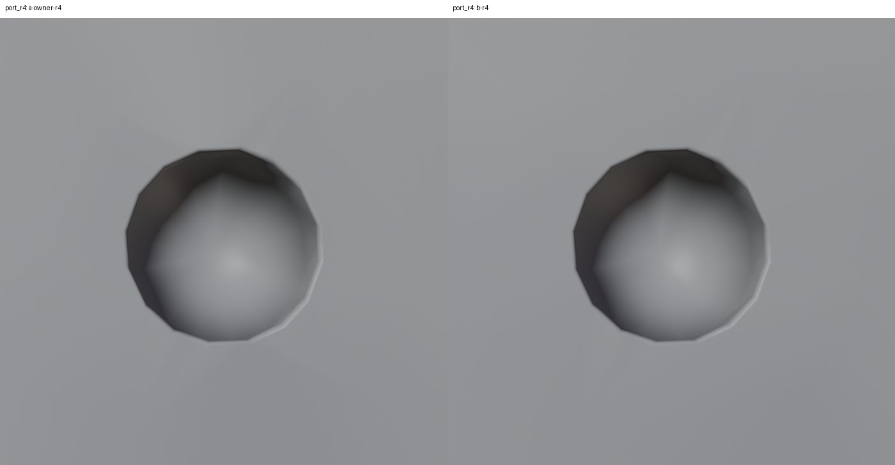
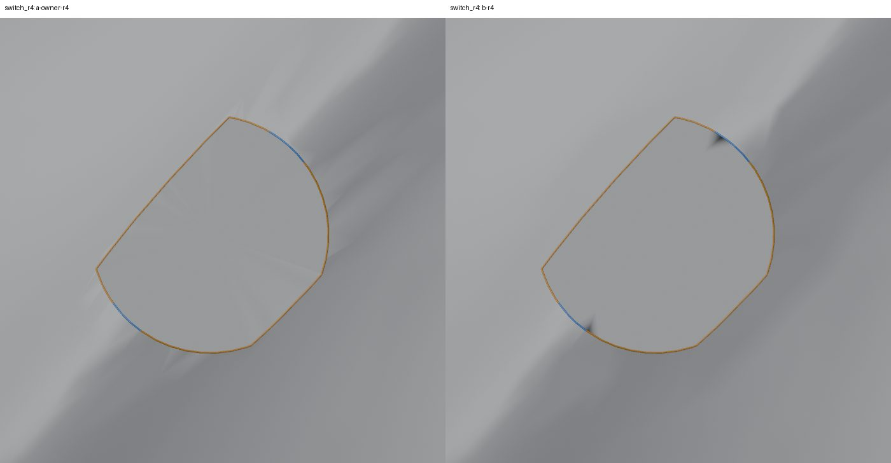

### (c) spade replaces Triangle

- spade caps match or beat round 3's Triangle caps:
  - split: cap worst 0.058 to 6.8 to 7.6 deg (round 3, Triangle: 5.5), cap slivers 4 to 8;
  - crease box: cap slivers 0, cap worst 6.9 to 7.4 deg (round 3: 3 slivers, 0.71 deg).
- No seam vertex was moved or split (driver assertion; seam off-plane 0; crack 0).
- Licence: MIT OR Apache-2.0, quoted above. It satisfies `no-unownable-tools-in-loop`.

### (d) Planar brush facets re-triangulated

Each planar brush facet the hull trimmed (one holding a loop edge) is re-triangulated in its own plane by spade.
Its boundary edges (loop and brush edges) are constraints, with interior Steiner points only. No boundary edge
was lost in any case (`constraint_edges_missing` 0), so loop and brush edge weights survive.

| case | variant | brush slivers | brush worst | brush p5 | seam-adjacent edges < bw |
|---|---|---|---|---|---|
| box across ridge | naive | 48 | 0.070 | 0.41 | 4 |
| | r4 (facet CDT, Steiner inside only) | 48 | 0.19 | 0.47 | 3 |
| | r4 + split brush edges (variant) | 5 | 4.91 | 18.1 | 5 |
| box in flank | naive / r4 / split variant | 1 / 0 / 0 | 0.29 / 6.9 / 13.7 | | 0 |
| add box | naive / r4 / split variant | 4 / 1 / 0 | 3.0 / 5.0 / 17.8 | | 0 |
| switch (cylinder walls) | owner-r4 / r4 / split variant | 11 / 16 / 36 | 0.06 / 0.30 / 0.30 | | 16 / 22 / 28 |

- **As called, (d) does not fix the ridge box.** Its 48 slivers are fans from a dense trimmed loop edge to the two
  ends of one long brush edge. Under `keep_constraint_edges` no Steiner point may land on that edge, so spade added
  only 3 points.
- **The variant** puts evenly spaced collinear points on long brush edges (never loop edges), shared by both facets
  on that edge. It removes them: 48 to 5 slivers, worst 4.9 deg. The edge stays where it is and both halves keep its
  weight. The neighbouring untrimmed facet is re-triangulated too.
- **On the curved cutters' planar wall quads it makes things worse** (switch 11 to 16 to 36 slivers), and more
  seam-adjacent edges fall under the bevel width. Those quads are narrow strips, and the sliver test flags any
  triangulation of them.

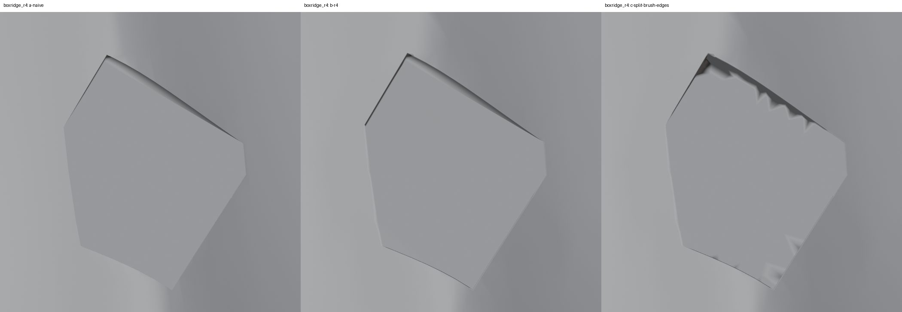
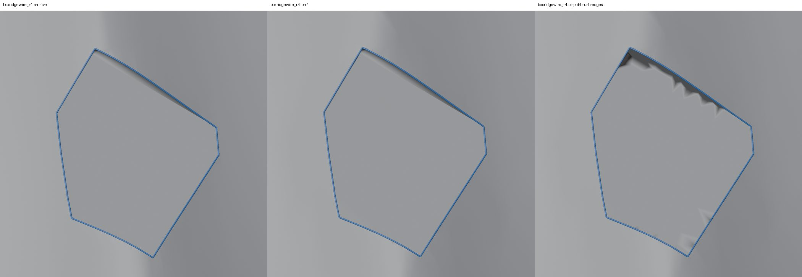
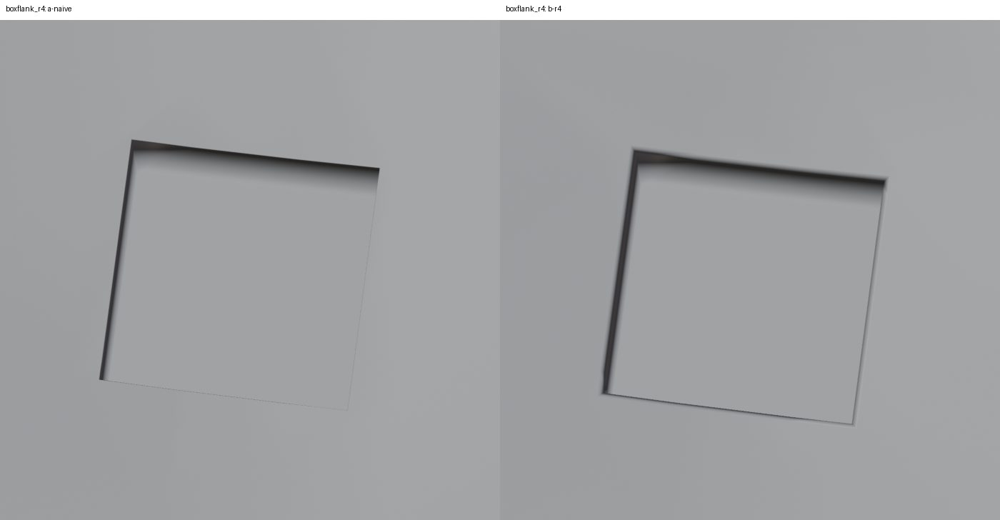

### (e) Add mode

Cases: an oriented box raised panel (half-width 0.025, 0.02 proud) at the flank box's placement, and a 16-segment
cylinder boss (r 0.015, 0.02 proud) at the gun port.

| case | variant | hull slivers | hull worst | brush slivers | brush worst | seam-adjacent edges < bw | corners kept |
|---|---|---|---|---|---|---|---|
| add box | naive | 10 | 0.44 | 4 | 3.0 | 0 | |
| | owner-r4 | 10 | 0.44 | 2 | 3.0 | 0 | 4 / 4 |
| | r4 | 4 | 2.37 | 1 | 5.0 | 0 | 4 / 4 |
| add cylinder | naive | 19 | 0.11 | 16 | 0.15 | 6 | |
| | owner-r4 | 4 | 3.92 | 0 | 7.6 | 0 | |
| | r4 | 4 | 5.47 | 0 | 7.8 | 0 | |

- **The same rule holds on the union loop.** The hull owns every stretch of the box (28 hull-owned loop vertices,
  its 4 corners protected) and the cylinder owns its loop (38 / 38), exactly as for subtract.
- **The concave loop's bevel:** 25 strips on the box loop and 28 on the cylinder loop, none collapsed, no edge
  under the bevel width, so the clamp does not narrow it.
- **The render's box walls are smooth-shaded into the floor**, a dark gradient. The brush's own edges carry no
  weight in this render, and Weighted Normal smooths across the 90 deg box edges. Production gives brush edges
  their row weight (`bevel-weights-carry`). This is a render-setup gap, not a weld result.

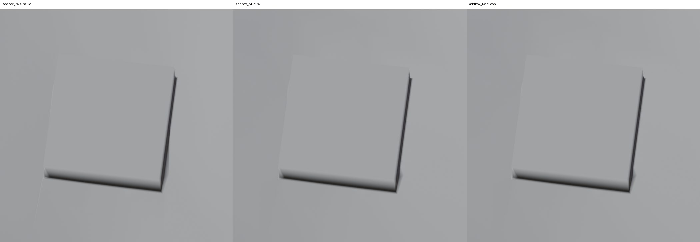
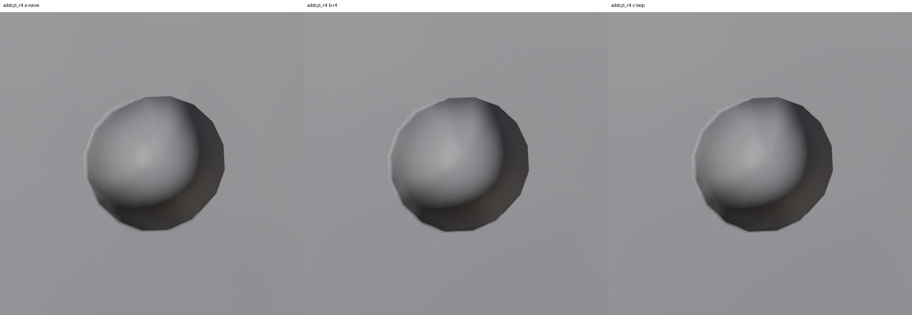

### (f) UV0 carry-through

The operator asked: "Isn't every face present in either mesh operand?"

- **Yes, out of the boolean.** Every one of every naive result's faces (4,404 to 6,238 per mesh, 11 meshes) is a
  fragment of one operand face: a hull quad or a planar brush facet. Each takes its UVs exactly by barycentric
  interpolation in that face. boolmesh carries only one per-corner scalar, so the spike rebuilds UVs from face
  provenance plus position. Manifold would carry UVs as properties.
- **After the weld, some faces are no longer single-face fragments.** Merges, slides and flips join corners from
  two neighbouring operand faces: 5 to 88 hull faces per mesh (`not_fragments_hull`). Each corner still lies on the
  hull surface and takes its UV from the operand face it lies on.
  - With UV0 seams protected, their stretch stays within 0.25x to 3.9x of the hull's density on the panel split, box
    cut-ins and adds. The crease box's intersect piece has one face nearly collapsed in UV (sigma_min 3e-5). Before protection the split reached 820x.
  - The switch (88x) and the crease notch (109x) still show it: cutter-owned `loop` and `ring` merges there pull a
    corner across a UV seam that no protected vertex marks.
- **Hull UV0 islands:** unchanged in count on the gun port, box cut-ins, adds and the switch (11 of 11). Hull-side UV
  flips are 0 everywhere except the crease box's intersect piece (1).
  - The crease box's pieces gain islands: 11 source islands appear as 14 and 4 in place of 11 and 3. Some welded
    faces there no longer share UVs with their neighbours along an edge.
  - Not solved: the protection covers seam crossings and seam vertices, not every corner that a merge pulls into
    another island's face.
- **Brush-side UV flips** (58 to 433) are subtract and split caps whose faces are reversed relative to the operand
  face. Their UVs are mirrored relative to the face. A brush chart for a cut wall needs a mirrored placement or a
  flip at assignment.
- **Split caps:** both pieces' caps are fragments of the same cutter face, so carried UVs coincide exactly (max
  difference 1e-15) and the two caps overlap in UV0. `uv-bar` wants unique UV0, so one cap's chart must be placed
  apart. That is a placement rule, and the follow-up's question.
- **Bevel strips** (`bmesh.ops.bevel`, the modifier's own BM bevel, with its settings, on a copy; loop strips only):
  - Every strip on every mesh takes the hull side's UVs (spans: hull 100 %, including hull-to-cap strips on
    splits). That holds wherever this spike looked, though BMesh documents no rule for which side a strip takes.
  - Stretch, relative to the hull's density: the narrow direction is compressed (sigma_min median 0.46 to 0.81;
    p5 0.22 to 0.67). The long direction is near 1 (sigma_max median 0.95 to 1.22; p95 1.05 to 2.9).
  - Outliers: 19.8 on the split's intersect piece, 96 to 156 on the crease box, at strips beside the welded faces
    above. No strip collapsed except 1 on the crease box.
  - So strips need no UV placement of their own. They inherit a slightly compressed copy of the hull chart, which a
    livery mask sampling UV0 will show as the hull's paint running into the groove.
  - The one measure that failed: the switch's owner-r4 mesh returned zero density (`collapsed` 80 of 80). It is a
    measuring fault on that mesh; its r4 row is normal.

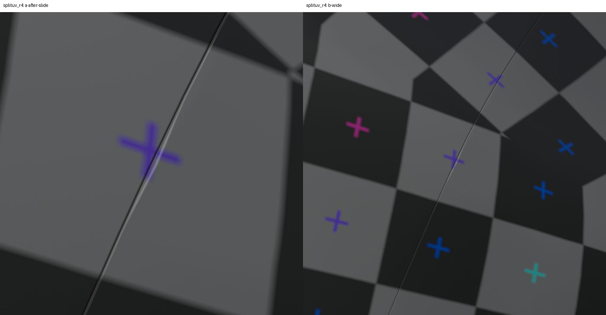
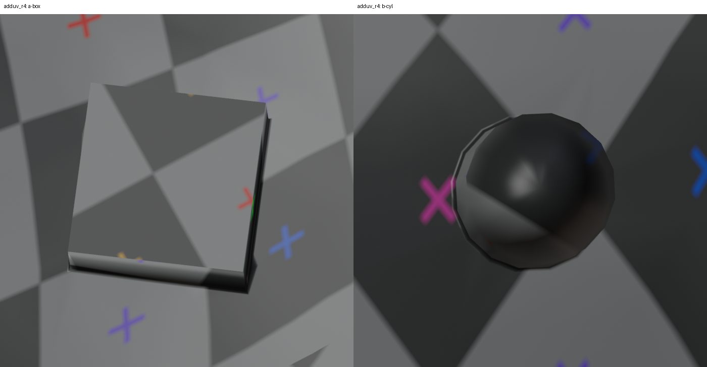

### Did each call hold

- (a) Built and measured. The split's needle goes (0.68 to 1.37 deg; edges under the bevel width 15 to 4) and
  the crease box's short edges go (12 to 1 and 0). It is not uniform yet: one slide is refused to keep UV0 whole, and
  the light wedge remains. Her eye decides the reading.
- (b) Held. The loop no longer moves on hull stretches.
- (c) Held. spade (MIT OR Apache-2.0) replaces Triangle and does as well or better.
- (d) Held as specified but does not fix the ridge box. It needs brush edges split collinearly (variant measured:
  48 to 5 slivers).
- (e) Held. The rule and corners work on the union loop, and its concave bevel is clean.
- (f) Answered yes for the boolean. The weld must not move UVs across UV0 seams: partly solved here.

### Open questions for Self (round 4), with a recommendation each

1. **Brush edges split for the CDT.** May the facet CDT put collinear points on a brush edge (never a loop or crease
   edge), shared by both facets, each half keeping the weight? Recommendation: yes for planar brush facets only,
   with a minimum spacing near the loop's. It is the only measured fix for the ridge box, and it moves no surface. Do
   not apply it to curved-cutter wall quads; it worsened them.
2. **UV0 seams as protected features.** Should a loop vertex on a UV0 seam, and a hull UV0 seam vertex, be
   protected like corners for every weld step (merges, slide, flips)? Recommendation: yes, and extend it to
   cutter-owned `loop` and `ring` merges, which still tear UVs on the switch and the notch. Her unwrap is authored
   state, and the weld must not cut through it. This costs one slide on the split.
3. **Split caps and reversed cut walls in UV0.** Recommendation: give each brush a UV chart (`brushes-own-surfaces`)
   and place the intersect piece's cap as a mirrored copy in its own tile. Then a carried cap UV is never shared, and
   a cut wall's mirrored winding is fixed at placement, not by the weld. That answers the follow-up's "who owns UV0"
   for created faces: the brush's chart. The hull's UV0 rides through by interpolation, so no unwrap after the weld
   is needed.
4. **The guard.** Round 4 judges compound operations by their end state, with a local worst-angle rule (never
   ending below 5 deg if it got worse). A per-step guard refuses operations whose intermediate state is degenerate.
   Recommendation: adopt the end-state guard in the weld's spec. It is target r4's own wording, "drops the band's
   worst angle below the floor".
5. **Her reading of "so they survive".** The split pair at the top of this section shows owner (hull) vertices
   moved by under the bevel width. Recommendation: ask her with that image. If she says no, the slide applies only to
   the yielding side, and the short merge alone takes the needle (the before image).

What remains unmeasured:

- Manifold's property carry (UVs through the kernel).
- A real unwrap of hers in place of the stand-in.
- The light wedge's exact clamp edges on the split.

## Round 3: Self's calls and ruling weld-owner-local-corners-kept

Inputs to this round:

- Self's calls: a flat split keeps its seam exactly on the cutter's plane; hull vertices survive; hull-side slivers
  along a flat seam are repaired by edge flips; the cap faces a cut leaves are ours and get a constrained Delaunay
  (CDT); worst-angle guard 5 deg.
- Ruling `weld-owner-local-corners-kept` (operator): ownership is local along the loop, and a hard-edged cutter's
  corners always survive.

How it was run:

- **Code:** `py/round3.py` for the flat seams; `py/owner_weld.py` with `NOSNAP_FLAT=1 MIN_ANGLE=5` for the curved
  cutters.
- **Ownership:** per loop vertex, by curvature along the loop. Nothing in the code takes a loop-wide vote.
- **Protected corners:** loop vertices on a sharp cutter edge (dihedral > 30 deg) or on a hull crease edge. They are
  never a merge source and never moved.
- **Edge flips:** greedy. A flip must raise the pair's worst angle and keep both normals within 20 deg. Seam and
  crease edges are constrained.
- **CDT:** Shewchuk's Triangle through the `triangle` package (Python wrapper LGPL-3.0; the Triangle core's licence
  bars commercial use, so it is fine for this spike and not shippable). Variants:
  - `cdt`: plain CDT, loop as the boundary.
  - `cdt-q`: CDT with a 20 deg quality bound, interior Steiner points only (`pq20Y`), so the seam is never split.
- **Short seam merge (`short`):** consecutive seam vertices closer than the 0.001 bevel width merge, jointly on both
  pieces. Both endpoints lie on the plane, so the seam stays on it. Only boolean-inserted vertices are merged away.
- **New probes:** a box cut into the curved flank (`probe_box_flank`, half-width 0.02) and a box across the dorsal
  ridge (`probe_box_ridge`, half-width 0.06). Each is rotated off the tessellation, with its sharp vertical edges on
  the loop.

Tables: `spikes/boolean-weld/results/round3/`.

### Flat seams (seam on the plane; hull side and cap reported separately)

| case | variant | hull slivers | hull worst deg | hull p5 deg | cap slivers | cap worst deg | flips | seam off plane | seam crack | seam-adjacent edges < bevel width |
|---|---|---|---|---|---|---|---|---|---|---|
| panel split, subtract piece | naive | 37 | 0.676 | 3.86 | 85 / 122 | 0.058 | 0 | 3e-16 | 0 | 15 |
| | flip + cdt | 28 | 0.676 | 4.69 | 80 / 122 | 0.122 | 0 | 3e-16 | 0 | 15 |
| | flip + cdt-q | 28 | 0.676 | 4.69 | 0 / 332 | 6.76 | 0 | 3e-16 | 0 | 23 |
| | short + flip + cdt-q | 26 | 0.676 | 5.30 | 1 / 313 | 5.50 | 0 | 3e-16 | 0 | 16 |
| panel split, intersect piece | naive | 32 | 0.539 | 4.36 | 85 / 122 | 0.056 | 0 | 3e-16 | 0 | 14 |
| | short + flip + cdt-q | 17 | 0.539 | 6.69 | 1 / 313 | 5.50 | 0 | 3e-16 | 0 | 16 |
| box across the crease, subtract piece | naive | 22 | 0.377 | 3.73 | 22 / 82 | 0.033 | 0 | 7e-16 | 0 | 12 |
| | short + flip + cdt-q | 12 | 2.41 | 6.64 | 3 / 147 | 0.714 | 0 | 7e-16 | 0 | 6 |
| box across the crease, intersect piece | naive | 25 | 0.0405 | 5.61 | 22 / 82 | 0.033 | 0 | 7e-16 | 0 | 11 |
| | short + flip + cdt-q | 10 | 0.0405 | 7.14 | 3 / 147 | 0.714 | 0 | 7e-16 | 0 | 5 |

- **Flips applied:** 138 and 99 on the split; 65 and 79 on the crease box.
- **Short seam merges:** 3 on the split, 4 refused by the 5 deg guard; 5 on the crease box, 1 refused. They move the
  seam polyline by at most 0.0069 % and 0.0040 % of the diagonal, within the plane.
- **The seam stays on the plane to float** (3e-16), the two pieces' seams coincide (crack 0), and nothing flips.
- **The cap CDT with interior refinement removes the cap's slivers.** Cap worst angle 0.058 to 5.5 deg (6.8 deg
  without the short merge); the crease box's cap reaches only 0.71 deg. Plain CDT cannot: the cap is a long thin
  polygon, and with no interior points its worst angle only reaches 0.12 deg.
- **The hull side's worst angle does not move** (0.676, 0.539 and 0.0405 deg). It is a triangle whose two vertices
  are a boolean-inserted seam vertex and a hull vertex almost on top of it. Flips cannot remove the edge between
  them: two nearly coincident points stay connected in any Delaunay-like triangulation. With both points pinned (the
  seam on the plane, hull vertices surviving), that angle stays. The seam-adjacent edges shorter than the bevel width
  remain for the same reason (15 to 16).
- **Render** (`r3_longinus_vs_split.jpg`, `r3_r3split.jpg`): the round-3 seam is straight, crisp and continuous for
  most of its length. That is better than round 2's kinks, and its seam no longer shows round 1's sliver highlight.
  Where the short seam-adjacent edges sit, the bevel narrows and a light wedge appears: Bevel's overlap clamp (on in
  the cage's own modifier) caps the width at the shortest adjacent edge. Turning the clamp off (`r3_r3clamp0.jpg`)
  gives a constant-width groove but overlapping bevel geometry: a spike on the round-3 seam, sawtooth on the naive
  one. So her uniform Longinus groove is not reached yet. Reaching it needs those near-coincident seam/hull vertex
  pairs resolved. Either the hull vertex moves onto the seam within the hull's own surface (it survives, displaced
  by less than the bevel width), or Self's no-move call is relaxed for vertices within the bevel width.

### Curved and hard-edged cutters (owner rule, local ownership, corners kept, 5 deg)

| case | variant | slivers | worst deg | p5 deg | flips | silhouette dev max | corners kept / total |
|---|---|---|---|---|---|---|---|
| gun port 16 (regression) | naive | 32 | 0.007 | 1.14 | 0 | 0.0198 % | 0 / 0 |
| | owner r3 | 5 | 5.09 | 6.68 | 0 | 0.0198 % | 0 / 0 |
| ownership switch r 0.08 | naive | 112 | 1.2e-6 | 0.62 | 0 | 0.0128 % | |
| | owner r3 | 53 | 1.2e-6 | 2.65 | 0 | 0.323 % | 4 / 4 |
| crease notch 16 | owner r3 | 10 | 4.31 | 6.83 | 0 | 0.061 % | 2 / 2 |
| box in flank (corners on loop) | naive | 3 | 0.285 | 6.62 | 0 | 0 | |
| | owner r3 | 2 | 0.285 | 9.61 | 0 | 0.0108 % | 4 / 4 |
| | hull-side flips (24) | hull 0 (was 2) | hull 6.0 (was 0.95) | hull 12.1 | 0 | 0 | 4 / 4 |
| box across ridge | owner r3 | 66 | 0.070 | 1.41 | 0 | 0.0014 % | 6 / 6 |
| | hull-side flips (118) | hull 7 (was 19) | hull 1.75 (was 0.72) | hull 7.24 | 0 | 0 | 6 / 6 |

- **Corners:** no corner was moved or lost in any case. `corners_kept_in_place` equals `corners` everywhere, and the
  guard turned away 4 merges on the flank box and 6 on the ridge box (`protected_corner`).
  - On the ownership-switch probe, the 4 corners are where the r 0.08 cylinder's floor rim breaks through the ridge.
  - On the crease notch they are the 2 rim-crease crossings; on the flat splits, the 4 crease crossings.
- **Ownership on the box cut-ins:** the hull owns every stretch (box faces have zero curvature along the loop), no
  vertex snaps (flat), and the box contributes its corners. That matches her "keep the first's corners".
- **The ridge box's pocket walls keep 48 slivers.** They are the cutter's own faces, trimmed by the hull. They are
  not a planar cap, so this round did not re-triangulate them.
- **The port regression is unchanged** from round 2: slivers 5, worst 5.09 deg, silhouette unchanged.
- **The ownership switch** keeps its owner-side 1.2e-6 deg needle and round 2's 0.32 % loop movement on the
  hull-owned stretches, where curved-cutter snapping is still on.

### Renders, round 3

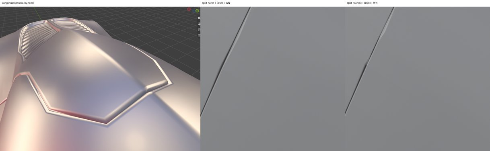

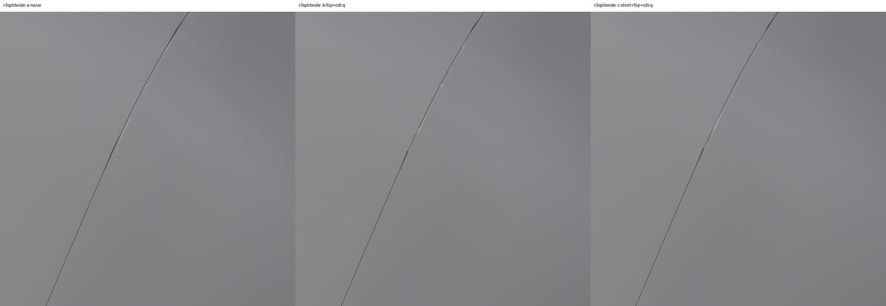
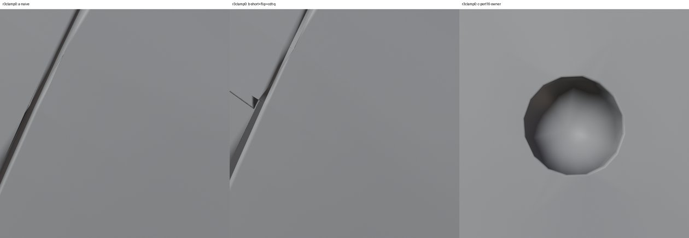
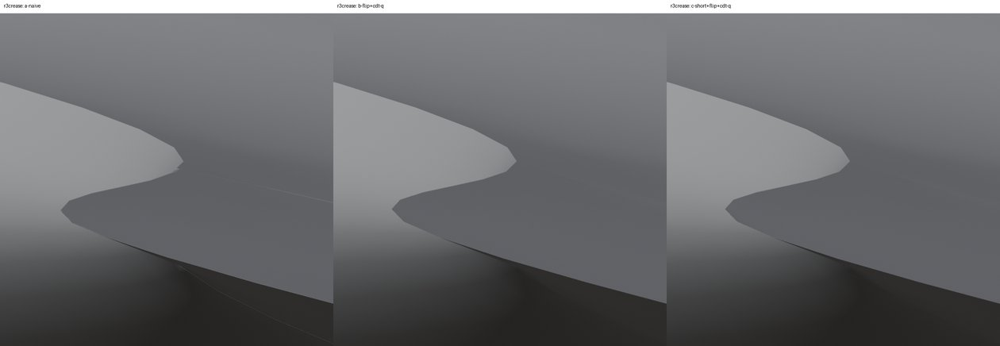
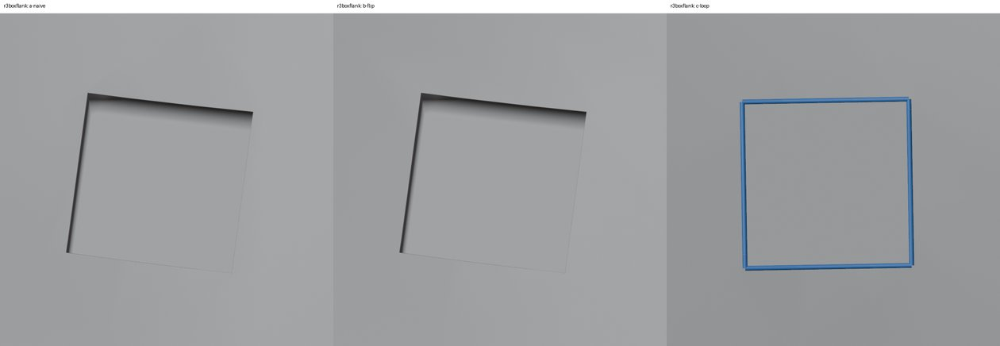
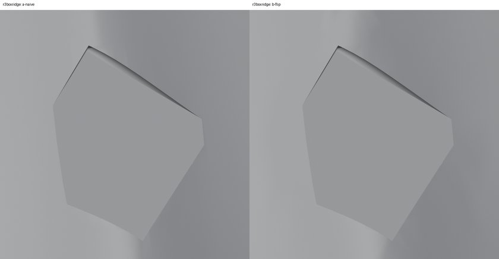
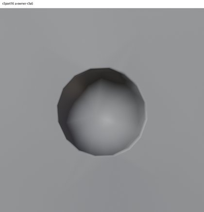
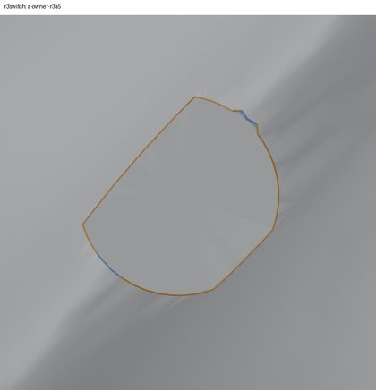

### Questions for Self (round 3, text only)

1. A flat seam's residual worst angle and short bevel-clamped edges come from a boolean-inserted seam vertex lying
   almost on a hull vertex. Under "seam on the plane, hull vertices survive" both are pinned. Should a hull vertex
   within the bevel width of the seam be allowed to slide onto the seam inside the hull's surface? It still survives,
   moved by less than 0.001.
2. Curved-cutter snapping on hull-owned stretches still moves the loop (switch probe 0.32 %). Should the round-3
   no-snap apply to every hull-owned stretch, curved cutter or not?
3. The CDT here uses Triangle, whose licence bars commercial use. A shippable cap CDT needs an owned implementation
   or a permissive crate (for example `spade`, a Rust CDT; not evaluated here).

## Round 2: ruling weld-owner-defines-silhouette

The operator answered round 1's question (ruling `weld-owner-defines-silhouette`, superseding
`boolean-cleanup-tighter-curve-wins`):

> "When i cut a panel line with a flat cutter, it's the hull's vertices that define the silhouette, so they survive,
> this is what the tighter curve rule is for. When I cut a small thing out of a bigger thing like your first example
> (which looks like a sphere cutting into a flat surface to make a dimple), the bigger thing is contributing fewer
> (none, in your example) vertices to the silhouette, so its vertices get merged away"

Implemented in `spikes/boolean-weld/py/owner_weld.py`, run by `py/run2.py`, with boolmesh output (Manifold's is
identical, round 1).

- **Owner:** curvature along the loop.
- **Spare vertices merged:**
  - `loop`: a loop vertex made only by the yielding side's edges merges into the nearest owner-made loop vertex.
  - `ring`: where the cutter owns, hull vertices one ring off the loop merge onto it.
  - `snap`: where the hull owns, a loop vertex the boolean inserted on a hull edge, within SNAP local edge lengths
    of an existing hull vertex, merges into that hull vertex. This is Self's specification: the hull vertex survives
    and the loop goes through it.
- **Splits:** both pieces are welded jointly, and every operation must pass both pieces' guards or it is refused.
  In the piece that lacks the surviving hull vertex, the loop vertex moves to it.
- **Guard thresholds:** worst angle 10 and 5 deg, both reported; SNAP 0.25 and 0.5 h.
- **New probe:** a vertical cylinder of r 0.03, 16 and 48 segments, cut through the wing-rim crease (a notch).

Full tables: `spikes/boolean-weld/results/round2/table2-*.md`. Tags: `a10s25` = 10 deg and SNAP 0.25 h; `a5s50` =
5 deg and SNAP 0.5 h; `r*` = the reverse snap direction.

### Answer, per case family

- **Small curved cutter in a larger surface (gun ports, dimple probes): the rule works.** The cutter owns the loop
  and the hull's spare vertices merge away.
  - Port, 16 segments, at 10 deg: slivers 32 to 5, worst angle 0.007 to 5.09 deg, p5 1.14 to 6.68 deg, silhouette
    unchanged (0.0198 %), 0 flips, 0 vertices moved outside the band. Edges under the bevel width touching the loop
    drop from 6 to 0. The 5 deg guard gives the same numbers.
  - At 48 segments the hull-side fans to the dense cutter remain: slivers 227 to 211 (10 deg) or 207 (5 deg). The
    cutter's tessellation should stay near the hull's density.
- **Flat cutter splitting the hull (panel line): the rule as specified does not fix the seam, and it bends it.**
  - At 10 deg and 0.25 h, both pieces accepted 16 of 78 snaps; 35 were refused on angle, 25 on flips and 2 on the
    link condition.
  - Slivers 97 to 85 on the subtract piece and 92 to 82 on the intersect piece.
  - The worst angle is unchanged: 0.058 deg and 0.056 deg.
  - Seam crack 0. The joint guard holds, so both pieces' loops stay identical.
  - At 5 deg / 0.25 h: 22 snaps applied, slivers 83 / 79. At 5 deg / 0.5 h: 54 applied, slivers 71 / 64.
  - Where they are: hull-side slivers barely move (37 to 35 and 32 to 32). The worst angle and most slivers (61 per
    piece) are in the planar cap's triangulation, which no vertex merge reaches.
  - The cost: the seam leaves the cutter's plane, by up to 0.40 % of the diagonal (0.23 h) at 0.25 h and 0.95 %
    (0.56 h) at 0.5 h. After Bevel and Weighted Normal this shows as visible kinks and a step in the panel line
    (`r2_splitclose.jpg`). The naive seam stays straight apart from one bright sliver highlight. Her Longinus seams
    are straight bevelled grooves (`r2_longinus_vs_split.jpg`).
  - The reverse direction does no better. Sliding the hull vertex onto the loop keeps the seam on the plane, but the
    guards refuse nearly all of it (1 of 78 applied at 10 deg / 0.25 h; 11 of 156 at 5 deg / 0.5 h), and it moves
    hull vertices up to 0.38 h off the hull surface.
- **Equal curvature, saddle, ownership switch: the rule cleans up but does not reach the needles.**
  - Slivers: equal-k 87 to 35 (10 deg) or 31 (5 deg); saddle 50 to 25 or 26; switch 112 to 54 or 53.
  - Worst angle: the 1e-6 to 3e-3 deg needles survive at 10 deg. At 5 deg equal-k reaches 0.71 deg.
  - The hull-owned stretches now snap, so the loop moves where ownership flips to the hull: equal-k 0.056 to 0.098 %
    (0.13 h), switch 0.013 to 0.32 % (0.16 h).
  - The saddle's 1 "flipped" near-vertical sliver remains at 10 deg and is gone at 5 deg.
- **Crease: the rule works.**
  - Curved cutter (the notch): the cutter owns the arc and the hull owns at the 2 crease crossings (6 of 41 loop
    vertices at 16 segments, 4 and 6 owner switches). Both crease vertices survive, no collapse uses a crease vertex
    as its source, and the hull's crease bevel weights are untouched (144 weighted edges before and after).
  - Notch results at 10 deg: 16 segments, slivers 27 to 8, worst angle 0.21 to 3.91 deg (4.31 at 5 deg), edges under
    the bevel width 4 to 0, silhouette 0.043 to 0.061 %; 48 segments, slivers 64 to 27, worst angle 0.10 to 0.79 deg.
  - Box across the crease: like the panel split, 40 of 44 slivers remain, the worst angle is unchanged, the seam
    crack is 0 and the seam moves 0.26 h.

### Renders, round 2

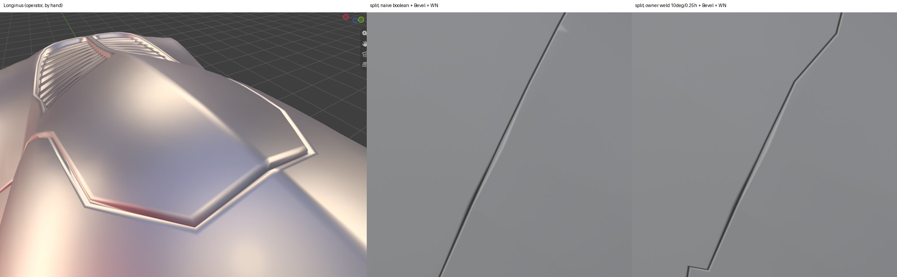

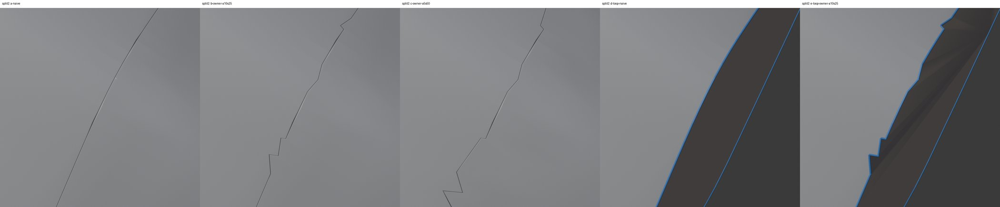
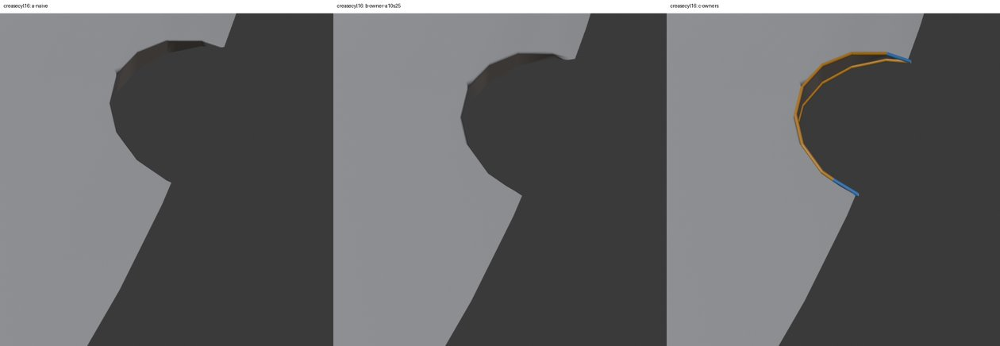

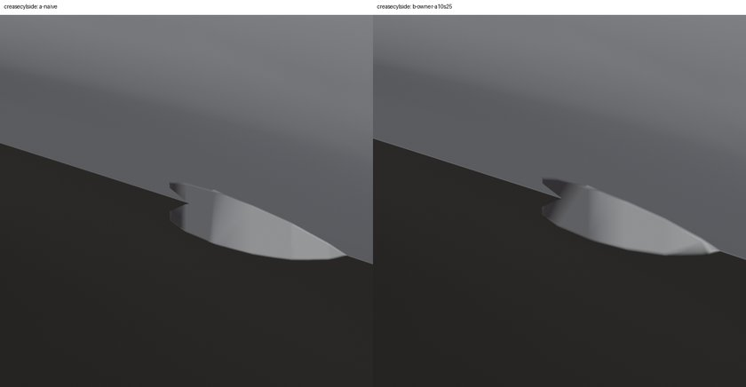

### Questions for Self (round 2, text only)

1. On a panel split, the snap makes the hull's vertices the seam's path as well as its silhouette, and the seam
   kinks. Should the hull vertices survive while the seam stays on the cutter's plane? If so, the seam's cleanup is
   not a vertex merge but a retriangulation of the cap and of the hull faces next to the loop. That is untested;
   both pieces would get the same loop, so no crack.
2. The cap's triangulation holds the worst angle and most slivers of every planar split, and the cap is kept for the
   bevel. Is the cap ours to remesh? It is interior, planar and invisible except through the Bevel and Weighted
   Normal it feeds.
3. Angle bar: 5 deg lets more merges through (split 22 vs 16 at 0.25 h; equal-k worst angle 0.71 vs 1.7e-6) and
   never produced a flip. 10 deg is safer on the saddle. Both are reported; Self decides.

## Round 1

### Answer

- **As the plan wrote it (owner by curvature across the loop, `u = n x t`), the rule fails on the gun port.** A
  cylinder has zero curvature across its own cut loop (that direction is its axis), so the hull owns 34 of 36 loop
  vertices and the weld merges away the cylinder's circle samples. The port's silhouette error doubles (max 0.0198 %
  to 0.045 % of the diagonal) and the worst angle does not improve (0.007 deg).
- **Measured along the loop (`k = II(t, t)` on each surface), the rule works for the gun port.** The cylinder owns
  every loop vertex, the 10 hull-made loop vertices merge onto it, and none is refused. Slivers in the band drop from 32 to 5. The minimum
  angle goes from 0.007 to 5.1 deg and the 5th percentile from 1.1 to 6.7 deg. The silhouette is unchanged, nothing
  flips and no vertex moves outside the band. Edges shorter than the bevel width touching the loop drop from 6 to 0,
  so the shipped Bevel's clamp no longer chokes the seam: the render shows a continuous bevel highlight where the
  naive cut has almost none. This reading, the curvature that bends the cut curve, matches her sentence ("defines
  the silhouette of the cut"). That is inference, and a question for Self below.
- **For the panel split the rule is a no-op.** A planar cutter contributes no loop vertices, since every one of the
  124 loop vertices is a hull edge crossing the plane. The hull owns all of them in every direction mode, and nothing
  merges. The 97 slivers in the band (37 hull-side, 60 in the cap; worst angle 0.058 deg) are the owner's own, and
  her rule does not speak to them.
- **Kernel: boolmesh 0.2.1.** It gives the same output as Manifold to the bit (identical vertex sets and triangle
  counts on every case), builds as pure Rust in 14 s on Windows, and carries provenance as a per-corner value.
  Manifold (manifold-csg 0.4.1 over Manifold v3.5.3) builds in 89 s on Linux and fetches upstream C++ source at
  build time.

### Inputs

- Hull: `Dexter Quiet Cage` re-exported from a copy of Ships.blend with Bevel and Weighted Normal off (Mirror, then
  Subsurf level 3 with limit surface): 3,010 vertices, 6,016 triangles, 0 non-manifold edges, 0 misoriented, Euler 2
  (watertight, genus 0), diagonal 1.4584, mean edge 0.0256 (p5 0.0067, p95 0.048). The 144 evaluated crease edges
  equal the cage's bevel-weight edges (midpoint match 8e-8). Fixtures: `spikes/boolean-weld/fixtures/`.
  `cage_eval.obj` (3,154 vertices, Bevel baked in) was not used.
- Curvature: a per-vertex quadric fit over the 2-ring of the evaluated mesh, giving a 3x3 second fundamental form;
  sign positive for convex. This is not the limit-surface `X = S c` (S not extracted). Hull crease edges count as
  infinite curvature, so the hull always owns there. Cutter curvature is analytic: cylinder `e_theta e_theta^T / r`,
  box faces 0.
- Cutters (`cases.py`). Gun port: cylinder r 0.015 on the upper flank at (0.17, 0.0), axis on the face normal,
  sunk 0.02, 16 and 48 segments. Split: box over y > 0.22, a transverse break round the forward body; both pieces
  kept. Probes:
  - equal-k: cylinder r 0.0199 = 1/|k|max at hull vertex 1799.
  - saddle: cylinder r 0.015 at vertex 538, k1 = -7.0, k2 = 55.2. The hull is 0.0143 thick there, so the port is sunk
    0.0086, not 0.02.
  - crease: box x > 0.33, a chordwise split across the wing-rim crease.
  - switch: cylinder r 0.08 across the dorsal ridge.
  - True-curve reference: the same cylinder at 1,024 segments. For planes the boolean loop is exact.

### Weld pass (`py/weld.py`)

1. Loop = edges between a hull-provenance face and a cutter-provenance face, traced into cycles. Neither kernel
   returns the loop or each loop vertex's source edge, so origin is a geometric test: whether the vertex lies on an
   original hull edge (H), a cutter edge (C) or both (1.5e-6 tolerance).
2. Owner per loop vertex = larger |k|, ties to the hull. The direction modes are `across` (the plan), `along` and
   `mean`.
3. Collapses: a loop vertex of yielding-side origin merges into the nearest owner-origin loop vertex along the loop.
   The `literal` scope also merges the yielding surface's one-ring onto the loop; `looponly` does not.
4. Guard: refuse a collapse on a face flip (old·new normal <= 0), on a worst angle below 10 deg when it got worse,
   on a missing edge, or on a failed link condition. Refusals are counted, never forced.
5. Split: collapses from the subtract piece are replayed by position on the intersect piece.
6. Candidate change tested (`-snap`), not her rule: the owner's own vertices within 0.25 local edge lengths of a loop
   vertex, and loop edges shorter than the 0.001 bevel width, also collapse, with the same guard.

### Measures (boolmesh; Manifold's numbers are identical)

Band = triangles whose centroid is within 2 local edge lengths of the loop. Sliver = longest edge squared over twice
the area > 10, or area < 1e-4 of the mean. Dev = welded loop polyline to the true intersection curve, in % of the
diagonal and in local edge lengths h. Out = hull vertices moved outside the band.

| case | variant | collapses | band tris | slivers | min deg | p5 deg | flips | dev max % | dev max /h | out |
|---|---|---|---|---|---|---|---|---|---|---|
| port s16 | naive | | 157 | 32 | 0.007 | 1.14 | 0 | 0.0198 | 0.0096 | 0 |
| port s16 | across (plan) | 12 | 133 | 12 | 0.007 | 2.83 | 0 | 0.045 | 0.022 | 0 |
| port s16 | **along** | 10 | 137 | **5** | **5.09** | **6.68** | 0 | 0.0198 | 0.0096 | 0 |
| port s48 | naive | | 339 | 227 | 0.016 | 0.92 | 0 | 0.0023 | 0.0011 | 0 |
| port s48 | across | 19 | 301 | 173 | 0.016 | 1.47 | 0 | 0.0064 | 0.0031 | 0 |
| port s48 | along | 8 | 323 | 211 | 0.47 | 1.57 | 0 | 0.0023 | 0.0011 | 0 |
| port s48 | along-snap | 40 | 259 | 119 | 0.93 | 2.25 | 0 | 0.0055 | 0.0027 | 0 |
| split sub | naive = every rule variant | 0 | 507 | 97 | 0.058 | 1.46 | 0 | 0 | 0 | 0 |
| split sub | along-snap | 7 | 496 | 85 | 0.058 | 2.07 | 0 | 0.0087 | 0.0051 | 0 |
| equal-k s16 | naive | | 457 | 87 | 1.5e-6 | 1.65 | 0 | 0.056 | 0.072 | 0 |
| equal-k s16 | along | 38 | 359 | 38 | 1.7e-6 | 3.67 | 0 | 0.055 | 0.073 | 0 |
| equal-k s48 | along | 53 | 506 | 73 | 0.157 | 2.98 | 0 | 0.0064 | 0.0082 | 0 |
| saddle s16 | naive | | 209 | 50 | 2.8e-6 | 0.61 | 0 | 0.094 | 0.067 | 0 |
| saddle s16 | along | 21 | 167 | 25 | 0.003 | 0.94 | **1** | 0.094 | 0.067 | 0 |
| saddle s48 | along | 28 | 309 | 83 | 0.003 | 0.85 | 0 | 0.012 | 0.0088 | 0 |
| crease sub | naive = every rule variant | 0 | 342 | 44 | 0.033 | 2.41 | 0 | 0 | 0 | 0 |
| switch s48 | naive | | 488 | 112 | 1.2e-6 | 0.62 | 0 | 0.0128 | 0.0062 | 0 |
| switch s48 | along | 48 | 392 | 57 | 1.2e-6 | 2.12 | 0 | 0.0196 | 0.0095 | 0 |

The full table (every variant, both kernels' rows, refusal counts) is in `spikes/boolean-weld/results/`.

Ownership per mode, as owner counts (hull / cutter) and owner switches per loop:

| case | across | along | mean |
|---|---|---|---|
| port s16 | 34 / 2, 4 switches | 0 / 36, 0 | 0 / 36, 0 |
| split | 124 / 0, 0 | 124 / 0, 0 | 124 / 0, 0 |
| equal-k s16 | 50 / 41, 10 | 21 / 70, 8 (11 within 10 % of a tie) | 16 / 75, 2 |
| equal-k s48 | 82 / 54, 10 | 24 / 112, 6 (15 near-tie) | 21 / 115, 2 |
| saddle s16 | 36 / 21, 18 | 9 / 48, 14 | 13 / 44, 10 |
| switch s48 | 79 / 53, 12 | 24 / 108, 4 | 22 / 110, 4 |

Shortest edge touching the loop, which bounds the bevel through Bevel's overlap clamp; the count is edges under the
0.001 bevel width:

| case | naive | across | along |
|---|---|---|---|
| port s16 | 5.3e-5 (6) | 5.3e-4 (4) | 2.3e-3 (0) |
| port s48 | 5.6e-5 (52) | 5.6e-5 (32) | 2.2e-4 (40) |
| saddle s16 | 1.4e-6 (19) | 1.4e-6 (3) | 1.4e-6 (9) |
| split | 2.6e-4 (15) | unchanged | unchanged |

### Per case

1. **Gun port, 16 segments.** With `along` the rule passes, apart from a 5.1 deg worst angle against a 10 deg guard.
   With `across` it fails (see Answer).
2. **Gun port, 48 segments (probe 5).** The rule keeps the cutter's dense samples, which is the right silhouette, but
   leaves 86 hull-side fans: hull vertices about 0.025 away fanned to cutter samples 0.002 apart. Another 125
   "slivers" are the cylinder's own wall quads, 0.05 tall by 0.002 wide, which are inherent to the cutter's
   tessellation and not caused by the boolean. The 16-segment cutter (spacing 0.0059, about 0.23 h) welds clean; at
   48 (about 0.08 h) only the snap variant helps much. The rule needs the cutter's spacing no finer than about a
   quarter of the hull's local edge length; finer than that, fans remain that no merge can remove.
3. **Panel split.** No-op, as above. The two pieces' loops coincide vertex for vertex (gap 0). Caps: with both caps
   kept, the bevelled seam reads as a panel line. With both caps dropped, nothing shows, because Bevel on an open
   boundary edge makes no seam. So the caps must stay for her panel-line method. The capped render shows a light
   streak partway along the seam, at the cap's sliver triangles (cutter side, worst 0.058 deg). Replaying the snap
   variant's collapses onto the second piece split the loops apart: the second piece refused 2 and could not match 1
   by position, opening a 6.8e-4 gap, a crack in the panel. A split's collapses must be accepted by both pieces'
   guards or by neither.
4. **Equal curvature (probe 1).** Ownership flickers: 6 to 10 owner switches per loop, and 11 to 15 loop vertices
   within 10 % of a tie in `along` mode. It produced no flips and no silhouette step (along dev 0.055 % against
   naive 0.056 %). When the two |k| are close, either owner gives about the same curve. The 1.5e-6 deg needle
   survives every variant: it belongs to the owner, and the rule never touches it.
5. **Saddle (probe 2).** The owner depends on the direction: across 36 / 21, along 9 / 48, mean 13 / 44, with 10 to 18
   switches. The hull's normal curvature there ranges from -7.0 to 55.2 with direction. Mean curvature gives fewer
   switches than along, but it answers a different question: how curved the surface is, not how much it bends the
   cut. After every weld variant one hull triangle in the band counts as "flipped" (normal · hull normal = -0.013,
   0.76 h from the rim crease): a near-vertical sliver whose normal is noise. It fails the zero-flip measure, and
   the cut here also reaches the crease (2 crease loop vertices).
6. **Cut across a crease (probe 3).** Passes, trivially. The 2 crease loop vertices are hull-owned (infinite k), no
   collapse happens near them, both crease vertices survive, and every crease edge keeps its bevel weight on both
   pieces (144 weighted edges become 126 + 20: the 2 crossed crease edges each split into weighted halves). Nothing
   merges across the crease. The plane contributes nothing to merge, so this probe does not stress the rule. A
   curved cutter across a crease would; it was not run.
7. **Ownership switch (probe 4).** Along the r 0.08 loop the owner switches 4 times. At the switch vertices: no
   flips, slivers 112 to 57, and a silhouette that moves from 0.0128 to 0.0196 % max (0.0095 h). The steps are
   below a tenth of a local edge. The worst angle stays 1.2e-6 deg, another owner-side needle. The render shows
   radial shading streaks round this cut in every variant, naive and welded: Weighted Normal over long hull-side
   fan triangles.

Locality held everywhere (invariant two-layers): 0 hull vertices moved outside the band in every case and variant.

### Renders

Each sheet shows the naive result, the ownership along the loop (blue = hull owns, orange = cutter owns) under
`across` and under `along`, and the welded results. Every result is shown after the shipped stack: Bevel 0.001,
1 segment, weight-limited, plus Weighted Normal, with settings copied from the cage's own modifiers, rendered
headless with Workbench. Loop edges carry bevel weight 1 and hull crease edges keep theirs.

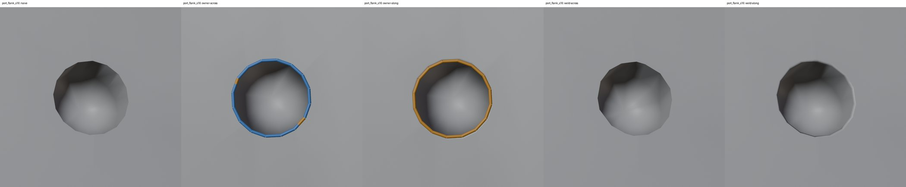
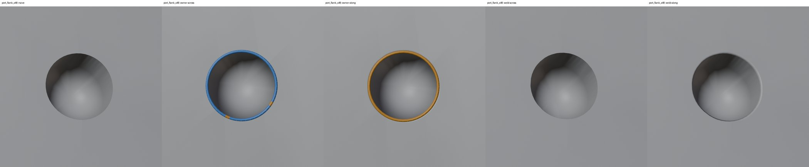
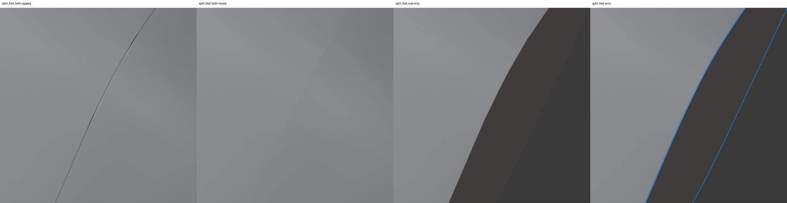
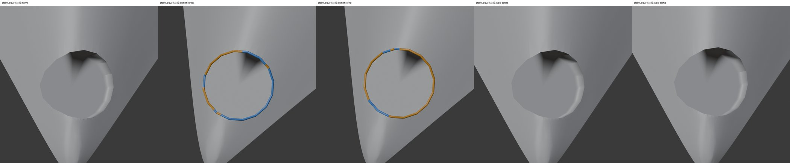
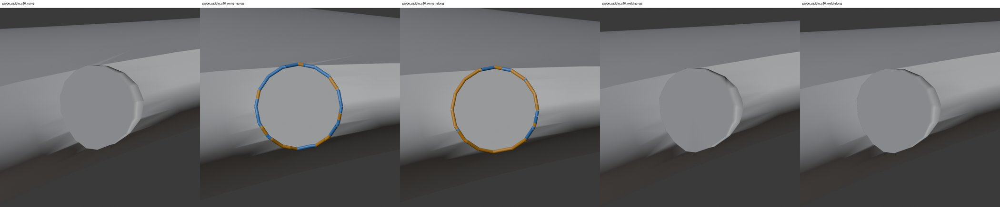
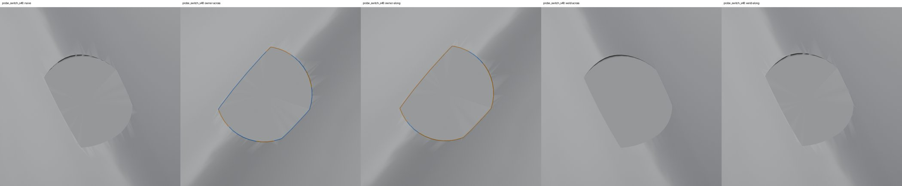
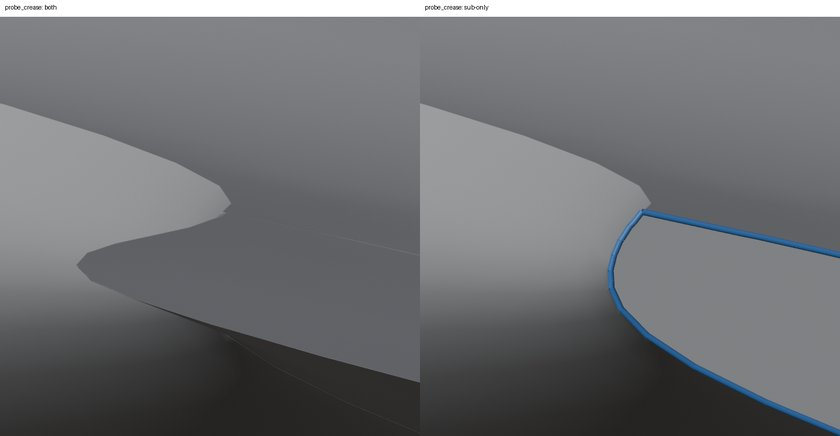

The split sheet shows four panels: both pieces with caps, both pieces without caps, the subtract piece alone, and the
loop. The crease sheet's framing is poor; its numbers carry the result. Her Longinus panel-line screenshot was not
available to this agent, so no side-by-side was made with it.

### Kernels

| | boolmesh 0.2.1 | manifold-csg 0.4.1 (Manifold v3.5.3) |
|---|---|---|
| licence | MPL-2.0 | Apache-2.0 OR MIT bindings over Apache-2.0 |
| build | pure Rust, 14 s release on Starfire (Windows) | C++ through the -sys build script, 89 s on Yggdrasil (Linux container, `eureka-verify-rust`); fetches Manifold source by git at build time |
| time per op | 8 to 25 ms | 13 to 20 ms |
| output | identical vertex sets (max difference 0.0) and identical triangle counts on all 11 cases | same |
| provenance | per-corner value carried through (0 hull, 1 cutter) | `run_original_id` with `run_index` after `as_original` |
| intersection loop | not returned; derived from provenance | not returned; derived from provenance |
| output before internal cleanup | not exposed (`simplify_topology` runs inside `compute_boolean`) | not exposed (`RemoveDegenerates` runs inside the op) |

The "naive" rows are therefore already after each kernel's own degenerate cleanup. It leaves worst angles down to
1e-6 deg, because epsilon-length collapse does not remove slivers with long edges.

### Smallest changes, in order

1. **Measure curvature along the loop, not across it.** This is the fix. Without it the rule fails the canonical
   gun port; with it the 16-segment port passes.
2. **Tie the cutter's tessellation to the hull's local density** (segment length about 0.2 to 0.3 h, never far
   finer). The rule keeps the tighter surface's samples; when those are much denser than the flatter surface's,
   fans remain that no merge can remove.
3. **Split seams need a cleanup the rule does not cover.** Two sources of slivers remain. One is the owner's own
   samples near the loop. The other is the planar cap's triangulation, which matters because the caps must be kept
   for the bevelled seam. Candidates, not tested: retriangulate the cap (it is planar and interior, so free to
   remesh), and collapse owner edges shorter than the bevel width. The `-snap` variant got only part of the way:
   slivers 97 to 85, worst angle unchanged at 0.058 deg.
4. **In a split, apply a collapse only if both pieces' guards accept it.** Replaying one piece's collapses opened a
   crack.

### Questions for Self, round 1 (answered: ruling weld-owner-defines-silhouette)

1. Does "the surface with the tighter curve" mean curvature along the cut, so that the circle comes from the
   cylinder? The plan's `u = n x t` formulation gives the opposite owner for every cylinder cut. The operator should
   confirm which reading she means; this spike's renders and numbers show the two.
2. For panel splits her rule never fires, since a plane is never tighter than the hull. Is the cleanup she does by
   hand on panel seams this same rule, or a different one (merging the hull's own near-loop vertices)? If it is
   different, the weld rule needs a second clause, and that is an operator call.
3. Is a 5 deg worst angle in the band acceptable for the shippable bar, or does the bar want the 10 deg the guard
   uses?
4. The path to the Longinus panel-line screenshot, for the side-by-side the plan asks for.
5. Should the curvature come from the cage's limit surface (`X = S c`) rather than the 2-ring quadric fit? The fit is
   noisy near creases and at the saddle, but no result here turned on it.
